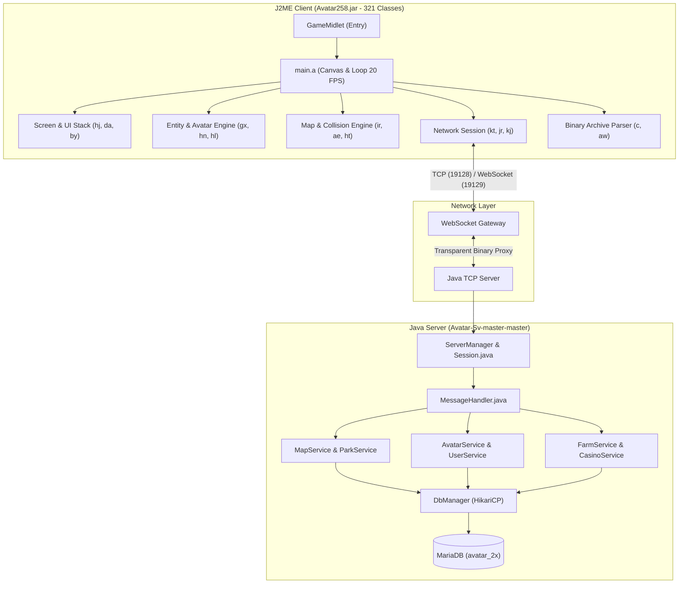
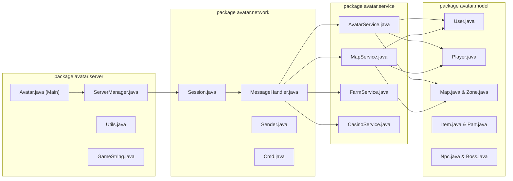

# BẢN ĐỒ TOÀN BỘ MÃ NGUỒN JAVA AVATAR 2.5.8
## (ARCHITECTURAL BLUEPRINT: CLIENT J2ME & SERVER JAVA)

> **Dự án:** Chuyển đổi Avatar Teamobi 2.5.8 sang WebGL Native & PHP Server  
> **Phiên bản gốc:** Avatar 2.5.8 (J2ME MIDP 2.0 / CLDC 1.1)  
> **Mã nguồn Server:** Java TCP Server (`Avatar-Sv-master-master`)  
> **Mã nguồn Client:** 321 Java Classes trích xuất và decompile từ `Avatar258.jar`  
> **Nguyên tắc kỹ thuật:** **100% Zero Remake** — Giữ nguyên logic tính toán, cấu trúc đối tượng và giao thức.

---

## I. TỔNG QUAN KIẾN TRÚC MÃ NGUỒN GỐC

---

## II. PHÂN TÍCH CHI TIẾT MÃ NGUỒN CLIENT J2ME (321 CLASSES)

Toàn bộ 321 file `.class` trong `Avatar258.jar` đã được phân tích, giải mã obfuscation và phân loại thành các phân hệ nghiệp vụ chính:

### 1. Phân hệ Khởi động, Vòng lặp & Quản lý Luồng (Core Engine)

| Tên Class | Kế thừa / Interface | Vai trò trong game | Cơ chế hoạt động cốt lõi |
|---|---|---|---|
| `main.GameMidlet` | `javax.microedition.midlet.MIDlet` | Điểm vào chính của ứng dụng | Khởi tạo Canvas `main.a`, nạp cấu hình hệ thống, quản lý chu kỳ sống `startApp`, `pauseApp`, `destroyApp`. |
| `main.a` | `javax.microedition.lcdui.Canvas`, `Runnable` | Trọng tâm vòng lặp Game Loop & Input | Duy trì nhịp 20 FPS (50ms/tick). Tách biệt luồng `run()`: gọi `update()` trước, `paint()` sau. Bắt toàn bộ phím cứng bàn phím và cảm ứng con trỏ. |
| `main.b` | `java.lang.Thread` | Luồng định thời gian thực | Quản lý bộ đếm mili-giây, FPS counter và các timeout sự kiện. |

### 2. Phân hệ Đồ họa, Bản đồ & Tileset (Graphics & Maps Engine)

| Tên Class | Kế thừa / Interface | Vai trò trong game | Cơ chế hoạt động cốt lõi |
|---|---|---|---|
| `ht` | `-` | Quản lý Graphics Context & Font | Cắt ghép chữ font bitmap (`assets/normal/font/normal`), đo chiều rộng chuỗi text, vẽ viền bóng chữ và chữ nhiều màu. |
| `ir` | `hj` | Engine Bản đồ Phòng (Room / Park Map) | Đọc file bản đồ nhị phân, render lớp gạch tileset (`tileset0.png`/`tileset1.png`), quản lý ma trận va chạm (`collision`), điểm chuyển khu (gate waypoints). |
| `ae` | `hj`, `cq` | Bản đồ Thế giới (City Map Screen) | Ma trận lưới 26x34 ô hiển thị toàn cảnh thành phố Avatar (Khu Nông Trại, Khu Giải Trí, Công Viên, Ngoại Ô...). |
| `cn`, `co`, `cp` | `-` | Bộ đệm tọa độ và Camera Viewport | Tính toán khoảng trượt camera mượt mà (smooth scrolling) theo nhân vật chính `localPlayer`, giới hạn biên bản đồ `xMin`, `xMax`, `yMin`, `yMax`. |

### 3. Phân hệ Nhân vật, Hoạt ảnh & Ghép đồ Đa lớp (Avatar & Entity System)

| Tên Class | Kế thừa / Interface | Vai trò trong game | Cơ chế hoạt động cốt lõi |
|---|---|---|---|
| `js` | `-` | Base Entity | Định nghĩa tọa độ `x, y`, hướng nhìn `direct`, tốc độ chạy `vx, vy`, trạng thái hiển thị. |
| `gx` | `js` | Avatar Base Model | Quản lý cấu trúc hình thể, hoạt ảnh đứng, bước chân (frame 1..4), chỉ số sức khỏe, năng lượng. |
| `hn` | `gx` | Nhân vật người chơi chính (Local Player) | Xử lý tọa độ di chuyển mục tiêu (`targetX`, `targetY`), kiểm tra bước đi hợp lệ, kích hoạt gửi gói tin di chuyển lên Server. |
| `hl` | `gx` | Người chơi khác trong cùng phòng (Remote Player) | Đồng bộ vị trí, nội suy bước chạy từ gói tin mạng gửi xuống, render tên và danh hiệu trên đầu. |
| `jy`, `jz` | `-` | Bộ cắt ghép trang phục đa lớp | Đọc metadata từ `part_*.dat` và `avatar_img_data.json` (1.139 slices), vẽ thứ tự Z-order: Bóng $\rightarrow$ Chân $\rightarrow$ Thân $\rightarrow$ Mặt $\rightarrow$ Tóc $\rightarrow$ Cánh. |

### 4. Phân hệ Mạng, Giao thức & Mã hóa (Networking & Protocol)

| Tên Class | Kế thừa / Interface | Vai trò trong game | Cơ chế hoạt động cốt lõi |
|---|---|---|---|
| `kt` | `-` | Network Session (TCP Socket Client) | Mở kết nối TCP Socket tới Server. Xử lý bắt tay nhận mảng khóa `key` qua Cmd `-27`. Thực hiện mã hóa XOR luân phiên toàn bộ byte vào/ra. |
| `jr` | `-` | Message Container | Đóng gói cấu trúc `[command: byte][data: byte[]]`. Tích hợp luồng đọc `dis` (`DataInputStream`) và ghi `dos` (`DataOutputStream`). |
| `kj` | `-` | Bộ giải mã thông điệp (Message Router) | Đọc mã lệnh `command` nhận được từ `kt`, định tuyến đến các phân hệ xử lý nghiệp vụ tương ứng. |
| `kk`, `kl`, `km` | `kj` | Trình xử lý chuyên biệt theo phân vùng | Xử lý các gói tin đặc thù: `kk` (công viên & khu công cộng), `kl` (nông trại), `km` (sòng bài/casino). |

### 5. Phân hệ Giao diện, Hộp thoại & Menu (UI & Interaction Framework)

| Tên Class | Kế thừa / Interface | Vai trò trong game | Cơ chế hoạt động cốt lõi |
|---|---|---|---|
| `hj` | `-` | Base Screen | Lớp trừu tượng cho mọi màn hình game. Chứa phương thức `update()`, `paint()`, `keyPressed()`, `pointerPressed()`. |
| `da` | `hj` | Màn hình Đăng nhập & Chọn Server | Form nhập tài khoản, mật khẩu, danh sách máy chủ, nút chọn phím mềm. |
| `bb` | `gy` | Hộp nhập văn bản & Chat bar | Xử lý nhập text, hiển thị bong bóng chat trên đầu nhân vật, danh sách biểu cảm nhanh. |
| `by` | `-` | Hệ thống Menu & Popup danh sách | Render danh sách cuộn dạng pop-up có con trỏ chọn, hỗ trợ cả điều khiển phím 2/4/6/8 và click chuột trực tiếp. |
| `cx` | `by` | Menu Hành động nhân vật (Action Menu) | Menu ngữ cảnh xuất hiện khi click vào người chơi khác: Kết bạn, Xem thông tin, Giao dịch, Cảm xúc (Ôm, Hôn, Tát...). |

### 6. Phân hệ Nông Trại & Chăn Nuôi (Farm & Animal System)

| Tên Class | Kế thừa / Interface | Vai trò trong game | Cơ chế hoạt động cốt lõi |
|---|---|---|---|
| `f`, `fa` | `hj` | Màn hình Nông trại chính | Quản lý 48 ô đất trồng, chuồng gà, chuồng bò, ao cá, cây khế, kho nông sản. |
| `fb`, `fc` | `-` | Vòng đời cây trồng & vật nuôi | Đếm thời gian sinh trưởng, giai đoạn sâu bệnh, cỏ dại, độ ẩm đất, sản lượng thu hoạch. |

### 7. Phân hệ Casino & Trò chơi Giải trí (Casino & Mini Games)

| Tên Class | Kế thừa / Interface | Vai trò trong game | Cơ chế hoạt động cốt lõi |
|---|---|---|---|
| `ca`, `cb` | `hj` | Bàn chơi bài Tiến Lên & Phỏm | Chia 52 lá bài, kiểm tra quy tắc bài hợp lệ, đếm ngược lượt đánh (turn timer), tính tiền phạt đền. |
| `cc`, `cd` | `hj` | Vòng quay may mắn & Đua thú (Pet Racing) | Hoạt ảnh bánh xe xoay góc lượng giác, hoạt ảnh 5 thú chạy trên đường đua, bảng cược và kết quả. |

### 8. Phân hệ Lưu trữ & Đọc Dữ liệu Container (RMS & Binary Archive)

| Tên Class | Kế thừa / Interface | Vai trò trong game | Cơ chế hoạt động cốt lõi |
|---|---|---|---|
| `c` | `-` | Trình giải nén archive `.av` | Đọc cấu trúc container nén chứa ảnh và sprite, giải mã theo thuật toán khóa đối xứng của Teamobi. |
| `aw` | `-` | Giao tiếp Record Management System (RMS) | Lưu trữ cấu hình tạm thời, thông tin ghi nhớ đăng nhập, cache dữ liệu quần áo trên bộ nhớ thiết bị. |

---

## III. BẢN ĐỒ MÃ NGUỒN JAVA SERVER (`Avatar-Sv-master-master`)

### 1. Chi tiết các Lớp Máy Chủ Cốt Lõi

1. **`avatar.server.Avatar`**:
   - Khởi tạo toàn bộ dịch vụ nền: nạp file cấu hình `config.properties`, khởi tạo `DbManager`, tải dữ liệu tĩnh (danh sách trang phục, bản đồ, NPC, vật phẩm shop) vào bộ nhớ.
   - Lắng nghe kết nối TCP trên cổng `19128`: `ServerSocket.accept()`.

2. **`avatar.server.ServerManager`**:
   - Quản lý danh sách các `Session` đang hoạt động trong toàn hệ thống.
   - Cơ chế dọn dẹp kết nối ngắt bất thường, thực hiện mở khóa tài khoản `users.login_lock = 0` và lưu trạng thái người chơi vào MySQL.

3. **`avatar.network.Session`**:
   - Đại diện cho 1 socket kết nối với client.
   - Chứa mảng khóa `key` sinh ngẫu nhiên theo thời gian thực: `(System.currentTimeMillis() + "_kitakeyos").getBytes()`.
   - Điều phối hai luồng chuyên biệt: `Sender` (luồng ghi gói tin) và `Receiver` (luồng đọc và giải mã gói tin XOR).

4. **`avatar.network.MessageHandler`**:
   - Trọng tâm định tuyến mọi gói tin nhị phân gửi từ Client.
   - Nhận diện Command ID và chuyển giao tham số tới các Service nghiệp vụ.

5. **`avatar.service.MapService`**:
   - Quản lý danh sách các phòng/khu (`Zone`) trong bản đồ.
   - Broadcast sự kiện người chơi di chuyển (Cmd 54), vào khu (Cmd 51), rời khu (Cmd 52), gửi tin nhắn chat (Cmd 55), cập nhật cảm xúc (Cmd 56).

6. **`avatar.service.AvatarService`**:
   - Quản lý giao dịch mua sắm, thay đổi trang phục, sử dụng vật phẩm, mở rương, nâng cấp chỉ số thân thiện, hạnh phúc, độ đói.

7. **`avatar.model.User` & `avatar.model.Player`**:
   - Thực thể người chơi ánh xạ trực tiếp từ 2 bảng MySQL `users` và `players`.
   - Quản lý số dư tiền tệ `xu`, `luong`, `luong_khoa`, danh sách đồ đang mặc `wearing` (JSON) và rương đồ `chests` (JSON).

---

## IV. BẢN ĐỒ ÁNH XẠ TOÀN BỘ CẤU TRÚC CLIENT JAVA SANG WEB ARCHITECTURE

| Thành phần Java J2ME gốc | Module Web TypeScript / PHP tương ứng | Thư mục mã nguồn Web |
|---|---|---|
| `main.GameMidlet.java` | `GameMidlet.ts` | `packages/game-client/src/core/GameMidlet.ts` |
| `main.a.java` (Canvas + Loop) | `CanvasMidlet.ts` | `packages/game-client/src/core/CanvasMidlet.ts` |
| `ht.java` (Font & Graphics) | `FontRenderer.ts` + `Graphics2D.ts` | `packages/j2me-compat/src/graphics/` |
| `ir.java` (Tilemap Engine) | `TilemapRenderer.ts` | `packages/game-client/src/maps/TilemapRenderer.ts` |
| `ae.java` (World Map) | `CityMapScreen.ts` | `packages/game-client/src/maps/CityMapScreen.ts` |
| `gx.java`, `hn.java`, `hl.java` | `AvatarRenderer.ts` + `GameWorldScreen.ts` | `packages/game-client/src/characters/` |
| `jy.java`, `jz.java` (Part Slicing) | `AvatarRenderer.ts` | `packages/game-client/src/characters/AvatarRenderer.ts` |
| `kt.java`, `jr.java` (Network Socket) | `NetworkSession.ts` + `Message.ts` | `packages/game-client/src/network/` |
| `bb.java` (Chat Box) | `in-game-chat-bar` + `sendChat()` | `packages/game-client/src/gameplay/` |
| `da.java` (Login Screen) | `LoginScreen.ts` + Web Portal PHP Form | `packages/game-client/src/screens/` + `public/index.php` |
| `c.java` (Archive Decoder) | `AvArchiveLoader.ts` | `packages/game-client/src/assets/AvArchiveLoader.ts` |
| `aw.java` (RMS Storage) | LocalStorage / SessionStorage Adapter | `packages/j2me-compat/src/io/` |
| `AvatarService.java` (Server Auth) | `AuthController.php` | `app/Controllers/AuthController.php` |
| `DbManager.java` (Server DB) | `Database.php` (PDO Singleton) | `app/Services/Database.php` |
