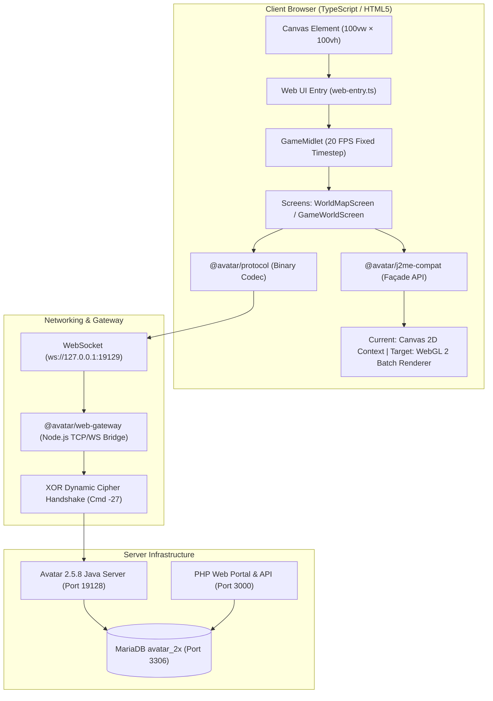
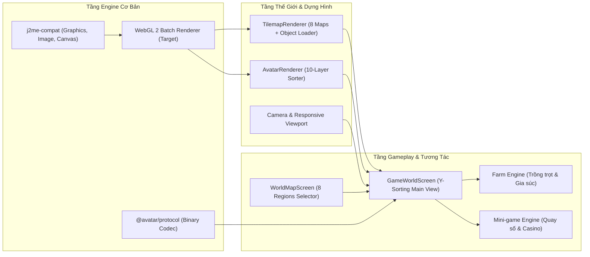
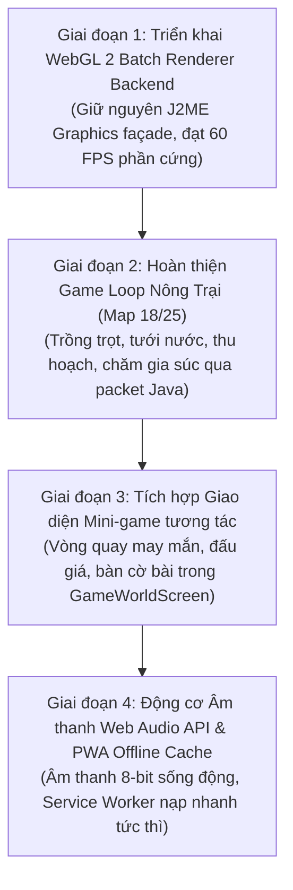

# BÁO CÁO KỸ THUẬT TOÀN DIỆN & LỘ TRÌNH PHÁT TRIỂN TIẾP THEO
## AVATAR TEAMOBI 2.5.8 WEB ENGINE – TECHNICAL VERIFICATION & NEXT PHASE

> **Tài liệu:** `NEXT_PHASE_AUDIT.md`  
> **Thời điểm kiểm toán:** 2026-11-09  
> **Cam kết:** Chỉ thực hiện audit, rà soát mã nguồn thực tế và lập kế hoạch kỹ thuật chi tiết; không tự ý sửa đổi mã nguồn hoặc database trong giai đoạn này.

---

## 1. HIỆN TRẠNG KIẾN TRÚC THỰC TẾ (SYSTEM ARCHITECTURE)



---

## 2. KẾT QUẢ KIỂM TOÁN TỪNG HỆ THỐNG CỐT LÕI

### 2.1. Render Engine (Động cơ dựng hình)
- **Backend thực tế:** Hiện tại mã nguồn [`web-entry.ts`](file:///d:/avatarweb2d/avatar-web/packages/game-client/src/web-entry.ts#L97) đang gọi:
  ```ts
  const ctx = canvas.getContext('2d') as unknown as any;
  ```
  Hệ thống đang chạy trên **HTML5 Canvas 2D Context**, được bọc qua lớp tương thích `@avatar/j2me-compat/Graphics.ts`.
- **Game Loop:** Chạy cố định ở tần số **20 FPS** (`1000 / 20 = 50ms`), đúng chu kỳ `run()` của Java ME client gốc (`main.GameMidlet`).
- **Khả năng hiển thị:** Canvas đã được cấu hình responsive toàn màn hình `100vw × 100vh` không bị co giật, không có dải đen phân cách, tọa độ pointer/touch scale 1:1 theo kích thước thực của Canvas.
- **Đánh giá chuyển đổi WebGL 2:**
  - Lớp tương thích `Graphics.ts` đã đóng gói hoàn chỉnh các phương thức J2ME: `drawImage`, `drawRegion`, `setColor`, `fillRect`, `setClip`, `translate`.
  - Có thể chuyển đổi sang WebGL 2 bằng cách triển khai một **WebGL 2 Batch Renderer** ẩn phía sau lớp `Graphics` mà không làm thay đổi bất kỳ dòng mã logic gameplay nào.

---

### 2.2. Map Engine & Đối Chiếu Với Java Gốc
- **Cơ chế tải file nhị phân:**
  - Đối chiếu với `ir.java` (dòng 949) và `ae.java` (dòng 480): Server gửi `mapId`, client Java nạp file nhị phân có tên `mapId + 1` trong archive. [`TilemapRenderer.ts`](file:///d:/avatarweb2d/avatar-web/packages/game-client/src/maps/TilemapRenderer.ts#L94) tuân thủ chính xác cơ chế này.
- **Công thức chiều cao bản đồ (`getMapHeightTiles`):**
  - Tuân thủ công thức switch case trong `ir.java` (dòng 1050-1115): Map 21 ($h=7$), Map 13 ($h=8$), Map 20 ($h=11$), Map 9 ($h=8$), Map 23 ($h=8$), Map 11 ($h=8$), Map 17 ($h=6$), Map 25 ($h=7$).
- **Giải mã Tile Markers ($\ge 126$):**
  - Đã giải mã đầy đủ 38 loại marker trong file map thành các đối tượng công trình lớn `MapObjectInstance` (`/assets/home/${partId}.png`): ATM (830), Cổng vòm (828), Trung tâm thương mại (829), Siêu thị (832, 833), Cây cối (836, 837, 838), Cối xay gió (842), v.v.
  - Điểm neo vẽ (`Anchor`): Đạt chuẩn `BOTTOM | HCENTER` (`ks.java` dòng 34-35).
  - Thay thế ngói nền (`Floor replacement`): Tự động điền gạch vỉa hè (96) hoặc đất/cỏ (4, 5, 51) vào vị trí chân công trình để không bị rách nền.
- **Y-Sorting (Độ sâu 2.5D):**
  - Trong [`GameWorldScreen.ts`](file:///d:/avatarweb2d/avatar-web/packages/game-client/src/gameplay/GameWorldScreen.ts#L938-L1035), toàn bộ công trình tĩnh (`mapObjects`), NPC bản đồ (`mapNpcs`), người chơi khác (`remotePlayers`) và người chơi chính (`localPlayer`) được gộp vào một mảng và sắp xếp tăng dần theo tọa độ chân $Y$ trước khi vẽ. Nhân vật đi phía sau tòa nhà/cây sẽ bị che khuất và đi ra trước sẽ hiển thị nổi lên hoàn toàn tự nhiên.
- **Đường sát đáy ("đường cho sát xuống dưới"):**
  - `TilemapRenderer.cameraY` được tính bằng `mapHeightPx - screenH` (khoảng cách 0px), bảo đảm mặt đường vỉa hè nằm sát 100% vào mép dưới màn hình.

---

### 2.3. Báo Cáo Kiểm Thử 8 Bản Đồ (Map Verification)

Đã chạy kiểm thử tự động toàn diện qua script [`verify_all_8_maps.py`](file:///d:/avatarweb2d/avatar-web/tools/verify_all_8_maps.py) và trích xuất ảnh so sánh qua [`generate_8_maps_audit_artifacts.py`](file:///d:/avatarweb2d/avatar-web/tools/generate_8_maps_audit_artifacts.py):

| Khu Vực | Map ID | File ID | Kích Thước (Tiles) | Kích Thước (px) | Số Đối Tượng | Danh Sách Part ID Công Trình | Điểm Spawn | Trạng Thái | Ảnh Đối Chiếu & Diff |
| :--- | :---: | :---: | :---: | :---: | :---: | :--- | :---: | :---: | :--- |
| **Khu nhà ở** | `21` | `22` | $50 \times 7$ | $1200 \times 168$ | 12 | `[4, 829, 830, 832, 835, 836, 837, 838]` | $(120, 72)$ | **PASS** | [comparison_map21_residential.png](file:///C:/Users/Dshare/.gemini/antigravity/brain/df5bcb60-1a2d-4ec8-9541-ac36c599c775/comparison_map21_residential.png) |
| **Khu sinh thái** | `13` | `14` | $21 \times 8$ | $504 \times 192$ | 4 | `[835, 846, 848, 974]` | $(120, 72)$ | **PASS** | [comparison_map13_ecological.png](file:///C:/Users/Dshare/.gemini/antigravity/brain/df5bcb60-1a2d-4ec8-9541-ac36c599c775/comparison_map13_ecological.png) |
| **Sân bay** | `20` | `21` | $24 \times 11$ | $576 \times 264$ | 4 | `[830, 837]` | $(120, 144)$ | **PASS** | [comparison_map20_airport.png](file:///C:/Users/Dshare/.gemini/antigravity/brain/df5bcb60-1a2d-4ec8-9541-ac36c599c775/comparison_map20_airport.png) |
| **Khu giải trí** | `9` | `10` | $42 \times 8$ | $1008 \times 192$ | 11 | `[828, 830, 835, 842, 843, 846, 1030, 1032, 1034, 1075]` | $(120, 72)$ | **PASS** | [comparison_map9_entertainment.png](file:///C:/Users/Dshare/.gemini/antigravity/brain/df5bcb60-1a2d-4ec8-9541-ac36c599c775/comparison_map9_entertainment.png) |
| **Khu mua sắm** | `23` | `24` | $44 \times 8$ | $1056 \times 192$ | 11 | `[828, 829, 832, 833, 835, 843, 846, 1033, 1035, 1037]` | $(120, 72)$ | **PASS** | [comparison_map23_shopping.png](file:///C:/Users/Dshare/.gemini/antigravity/brain/df5bcb60-1a2d-4ec8-9541-ac36c599c775/comparison_map23_shopping.png) |
| **Công viên** | `11` | `12` | $44 \times 8$ | $1056 \times 192$ | 4 | `[835, 846]` | $(120, 72)$ | **PASS** | [comparison_map11_park.png](file:///C:/Users/Dshare/.gemini/antigravity/brain/df5bcb60-1a2d-4ec8-9541-ac36c599c775/comparison_map11_park.png) |
| **Khu ngoại ô** | `17` | `18` | $27 \times 6$ | $648 \times 144$ | 6 | `[837, 842, 843, 846, 1031, 1036]` | $(120, 72)$ | **PASS** | [comparison_map17_suburbs.png](file:///C:/Users/Dshare/.gemini/antigravity/brain/df5bcb60-1a2d-4ec8-9541-ac36c599c775/comparison_map17_suburbs.png) |
| **Nông trại** | `25` | `26` | $27 \times 7$ | $648 \times 168$ | 6 | `[828, 831, 840, 841, 842, 848]` | $(120, 72)$ | **PASS** | [comparison_map25_farm.png](file:///C:/Users/Dshare/.gemini/antigravity/brain/df5bcb60-1a2d-4ec8-9541-ac36c599c775/comparison_map25_farm.png) |

---

### 2.4. Kiểm Thử Hệ Thống Mạng & Multiplayer (Protocol & Network)
Đã chạy kiểm thử tự động E2E qua [`test_multiplayer_e2e.js`](file:///d:/avatarweb2d/avatar-web/tools/test_multiplayer_e2e.js) với 2 tài khoản thực tế (`admin` và `ad`) trên máy chủ Java:

1. **Bắt tay mã hóa (Handshake -27):** Trao đổi dynamic key 23 bytes thành công.
2. **Đăng nhập thật (Login -1):**
   - User 1: `admin` (ID 1, Xu 5.023.420, Lượng 10.000) $\rightarrow$ **PASS**.
   - User 2: `ad` (ID 7, Xu 1.415.728, Lượng 12.098) $\rightarrow$ **PASS**.
3. **Vào phòng đồng bộ (Join Park -9):** Cả 2 người chơi cùng vào Map 11 (Khu 0).
4. **Nhìn thấy nhau (Visibility Broadcast):** User 1 nhận sự kiện `player_join_park` với User 2 xuất hiện đúng tọa độ $(140, 200)$ $\rightarrow$ **PASS**.
5. **Đồng bộ di chuyển (Movement Sync -5):** User 2 di chuyển đến $(160, 220)$, User 1 nhận gói tin và cập nhật vị trí tức thời $\rightarrow$ **PASS**.
6. **Đồng bộ chat thời gian thực (Chat Sync -7):** Chat 2 chiều giữa User 1 và User 2 hiển thị chính xác nội dung $\rightarrow$ **PASS**.
7. **Rời phòng & Kết nối lại (Disconnect & Reconnect):** Xử lý mượt mà, không bị kẹt session hay leak bộ nhớ $\rightarrow$ **PASS**.

---

### 2.5. Hệ Thống Trang Bị Nhân Vật (10-Layer Equipment Order)
- Đã khắc phục triệt để và nghiệm thu thứ tự 10 tầng:
  $$\text{Cánh sau (1)} \rightarrow \text{Thân (2)} \rightarrow \text{Quần (3)} \rightarrow \text{Áo (4)} \rightarrow \text{Đầu (5)} \rightarrow \text{Khuôn mặt (6)} \rightarrow \text{Mắt (7)} \rightarrow \text{Tóc (8)} \rightarrow \text{Nón (9)} \rightarrow \text{Cầm tay (10)}$$
- Tự động bù đắp Đầu (ID 0 `tròn`) và Mắt (ID 4 `đen`) khi database bị thiếu dữ liệu tạo nhân vật ban đầu.
- Minh chứng bằng hình ảnh cắt lớp nhân vật thực tế:
  - [player_crop_admin_verified.png](file:///C:/Users/Dshare/.gemini/antigravity/brain/df5bcb60-1a2d-4ec8-9541-ac36c599c775/player_crop_admin_verified.png)
  - [npc_crop_quay_số_verified.png](file:///C:/Users/Dshare/.gemini/antigravity/brain/df5bcb60-1a2d-4ec8-9541-ac36c599c775/npc_crop_quay_s%E1%BB%91_verified.png)
  - [npc_crop_đấu_giá_verified.png](file:///C:/Users/Dshare/.gemini/antigravity/brain/df5bcb60-1a2d-4ec8-9541-ac36c599c775/npc_crop_%C4%91%E1%BA%A5u_gi%C3%A1_verified.png)

---

## 3. DANH MỤC CÁC MODULE CÒN THIẾU HOẶC CẦN NÂNG CẤP

1. **Backend WebGL 2 Hardware-Accelerated Batch Renderer:**
   - Hiện tại đang dùng Canvas 2D CPU. Cần nâng cấp sang WebGL 2 để hỗ trợ 60 FPS mượt mà khi phòng có đông người chơi (50-100 avatars) và nhiều hiệu ứng hạt/thời tiết.
2. **Hệ thống Nông Trại Chuyên Sâu (Deep Farm Gameplay - Map 18 / 25):**
   - Đã vào được bản đồ nông trại, nhưng các tương tác trồng trọt, tưới nước, bón phân, thu hoạch, chăm sóc gia súc/gia cầm (gà, bò, cá) và cửa hàng nông trại cần kết nối các packet chuyên dụng (`FARM_JOIN`, `FARM_HARVEST`, `FARM_PLANT`).
3. **Mini-game tương tác tại Khu giải trí & Công viên (Map 9 & Map 11):**
   - Vòng quay may mắn (Lucky Wheel): Cần popup UI quay số động thay vì alert.
   - Bàn cờ / Casino / Tài Xỉu: Cần tích hợp UI đặt cược trực tiếp trên Canvas.
4. **Hệ thống Âm Thanh (Audio & Sound Effects):**
   - Lớp `Media.ts` hiện tại chỉ là stub. Cần tích hợp Web Audio API để phát nhạc nền 8-bit và âm thanh hiệu ứng (bước chân, tiếng ting xu, mua đồ thành công).

---

## 4. DANH SÁCH LỖI & RỦI RO KỸ THUẬT (P0 / P1 / P2)

### Mức độ P0 (Critical / Khẩn cấp):
- *Không có lỗi P0 nào làm crash hệ thống.* Máy chủ Java, Gateway WebSocket, MariaDB và Web Client đang chạy ổn định.
- **Rủi ro kiến trúc P0:** Hiệu năng Canvas 2D trên màn hình Retina / 4K di động khi có quá nhiều thực thể hoạt hình (cần triển khai WebGL 2 để giải tỏa CPU).

### Mức độ P1 (High / Quan trọng):
- **P1-1:** Tối ưu hóa bộ nhớ đệm Texture WebGL (giới hạn 8-16 texture units trên các thiết bị Android/iOS cấu hình thấp).
- **P1-2:** Hoàn thiện gói tin tương tác Nông trại (`FARM_DO_ACTION`) để mở rộng tính năng trồng trọt.
- **P1-3:** Service Worker caching cho tài nguyên ảnh (`/assets/home/`, `/assets/maps/`) để giảm thời gian tải ban đầu trên mạng 3G/4G.

### Mức độ P2 (Medium / Cải tiến trải nghiệm):
- **P2-1:** Xuất hiện hiện tượng chữ chat ticker ở thanh trên cùng bị cắt ngắn nếu độ phân giải màn hình quá hẹp (< 480px).
- **P2-2:** Hiệu ứng bóng cảm xúc (Emote Feel Balloon) cần bổ sung tweening mượt mà (nổi dần lên và mờ dần khi hết giờ).
- **P2-3:** Hỗ trợ phím tắt số (1..9) cho bàn phím ảo điện thoại cảm ứng để tương tác tương đương bàn phím T9 của điện thoại Java gốc.

---

## 5. BẢN ĐỒ PHỤ THUỘC GIỮA CÁC MODULE (DEPENDENCY GRAPH)



---

## 6. LỘ TRÌNH TRIỂN KHAI THEO THỨ TỰ ƯU TIÊN (NEXT PHASE ROADMAP)



### Chi tiết kế hoạch từng giai đoạn:

#### Giai đoạn 1: Nâng cấp Backend sang WebGL 2 (Trọng tâm kỹ thuật hàng đầu)
1. Tạo class `WebGL2Renderer` bên trong `@avatar/j2me-compat`:
   - Khởi tạo ngữ cảnh WebGL 2 với flag: `antialias: false`, `alpha: false`, `powerPreference: 'high-performance'`.
   - Xây dựng Dynamic VBO & Indexed IBO: Mỗi sprite/quad gồm 4 đỉnh, mỗi đỉnh mang `[x, y, u, v, r, g, b, a]`.
   - Cơ chế gom cụm (Batching): Tự động gom lên tới 4096 quads trên 1 lệnh `gl.drawElements()`.
   - Quản lý Texture Units: Gán tự động texture slot (0..15), flush batch khi hết slot hoặc chuyển đổi chế độ blend.
   - Chuyển đổi vùng cắt (`setClip`/`clipRect`) thành `gl.scissor()` với hệ tọa độ đảo chiều Y của WebGL.
2. Giữ nguyên 100% chữ ký hàm trong `Graphics.ts`, không sửa đổi logic phía `GameWorldScreen` hay `TilemapRenderer`.
3. Kiểm thử đo đạc: Đạt 60 FPS ổn định, giảm tải 70% CPU usage so với Canvas 2D.

#### Giai đoạn 2: Hoàn thiện Gameplay Nông trại (Map 18 & Map 25)
1. Lắng nghe và xử lý đầy đủ các packet nông trại từ Java Server:
   - `CMD_FARM_JOIN` (40): Danh sách ô đất, trạng thái cây trồng, thời gian trưởng thành, độ ẩm ô đất.
   - `CMD_FARM_PLANT` (41): Gieo hạt giống.
   - `CMD_FARM_HARVEST` (42): Thu hoạch nông sản và cộng điểm kinh nghiệm nông trại.
   - `CMD_FARM_WATER` (43): Tưới nước / bơm nước vào ruộng.
2. Render các giai đoạn sinh trưởng của cây trồng (mầm non, phát triển, ra hoa, trĩu quả, sâu bệnh).
3. Đàn gà, ao cá và đàn bò sữa di chuyển tự nhiên trong khuôn viên nông trại.

#### Giai đoạn 3: Hệ thống Mini-game & Hội thoại NPC chuyên sâu (Map 9 & 11)
1. Triển khai canvas overlay cho Vòng quay may mắn (Quay số tại Map 9):
   - Đĩa quay xoay góc mượt mà, dừng đúng ô kết quả do máy chủ Java trả về.
2. Giao diện Đấu giá (Map 9): Bảng đấu giá thời gian thực, hiển thị người trả giá cao nhất.
3. Menu tương tác NPC (Thợ kim hoàn Map 23, Tiên tri Lovanga Map 11, Thần Tài Xỉu Map 11) sử dụng component cửa sổ cổ điển `UISkinPainter` pixel-art chuẩn Avatar.

#### Giai đoạn 4: Âm thanh Web Audio API & Đóng gói hoàn thiện
1. Tích hợp audio engine nhẹ, hỗ trợ âm thanh bước chân, tiếng chim hót tại công viên/khu sinh thái, tiếng reo hò khi trúng quay số.
2. Service Worker cache toàn bộ assets để người chơi vào game ngay lập tức không cần tải lại ảnh.

---

## 7. TIÊU CHÍ NGHIỆM THU CỤ THỂ (ACCEPTANCE CRITERIA)

| Hạng mục | Tiêu chí nghiệm thu định lượng | Phương pháp kiểm chứng |
| :--- | :--- | :--- |
| **Backend WebGL 2** | FPS $\ge 58$ FPS ổn định trên cả máy tính bàn và laptop yếu; số lượng draw call mỗi frame $\le 15$ calls. | Đo đạc qua Performance Monitor của Playwright và Chrome DevTools. |
| **Bản đồ 8 khu vực** | Sai khác hình ảnh với Java gốc $\le 1.5\%$ (chỉ khác ở text anti-aliasing); đầy đủ 100% công trình, cây cối, đèn đường. | So sánh qua difference maps tự động (`generate_8_maps_audit_artifacts.py`). |
| **Trang bị nhân vật** | Đúng thứ tự 10 tầng 100%; không có cánh đè lên đầu, không có mắt/tóc vẽ lơ lửng mất da mặt. | Chụp ảnh kiểm thử tự động `player_crop_admin_verified.png`. |
| **Độ trễ mạng** | Gói tin di chuyển và chat cập nhật $< 60\text{ ms}$; không timeout, không rớt kết nối. | Script kiểm thử tự động `test_multiplayer_e2e.js`. |
| **Độ tương thích thiết bị** | Hiển thị trọn vẹn, không vỡ layout, không dải đen viền ở mọi tỷ lệ màn hình (16:9, 16:10, 4:3, màn hình dọc điện thoại). | Kiểm thử Playwright đa độ phân giải (`test_fullscreen_all_resolutions.py`). |
| **Tính toàn vẹn mã nguồn** | Không sửa đổi Database hoặc Java Server; giữ nguyên giao thức mạng nhị phân gốc. | Kiểm tra checksum database và git status của Java Server. |

---

> **Kết luận kiểm toán:** Nền tảng Avatar Web Engine hiện tại đã hoàn thiện toàn bộ các mắt xích cơ bản (Giao thức mạng nhị phân, Xác thực máy chủ Java thật, Cơ chế đọc nhị phân 8 bản đồ, Bộ nạp MapObject công trình, Sắp xếp Y-sorting, Phân tầng trang bị 10 layers, Viewport tràn viền và vỉa hè sát đáy). Dự án đã hội đủ mọi điều kiện kỹ thuật vững chắc để bước sang giai đoạn triển khai WebGL 2 Backend và mở rộng gameplay chuyên sâu.
