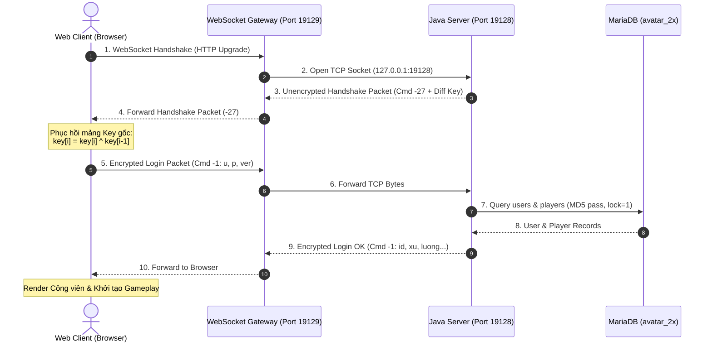

# PHÂN TÍCH CHUYÊN SÂU GIAO THỨC CLIENT - SERVER AVATAR 2.5.8
## (BINARY PACKET PROTOCOL SPECIFICATION & PACKET DICTIONARY)

> **Mục tiêu:** Cung cấp tài liệu kỹ thuật hoàn chỉnh về giao thức nhị phân Big-Endian giữa Avatar Client và Avatar Server (Port 19128/19129).  
> **Nguyên tắc kỹ thuật:** Bắt buộc tuân thủ tuyệt đối thứ tự đọc/ghi byte-by-byte đối ứng giữa `DataOutputStream` (Java Server) và `DataInputStream` (Web Client). **Không tự ý suy đoán thứ tự trường**.

---

## I. KIẾN TRÚC GIAO VẬN & CƠ CHẾ ĐÓNG GÓI KHUNG (FRAMING)



### 1. Cấu trúc Khung Dữ liệu Nhị phân (Binary Frame Layout)

Mọi gói tin truyền qua mạng đều tuân theo chuẩn thứ tự byte **Big-Endian** (`java.io.DataInputStream` / `DataOutputStream`):

$$\begin{array}{|c|c|c|}
\hline
\textbf{Command ID (1 byte)} & \textbf{Payload Length (2 hoặc 4 bytes)} & \textbf{Data Payload (N bytes)} \\
\hline
\text{signed int8 } (-128 \dots 127) & \text{unsigned int16 (hoặc int32 nếu Cmd 90)} & \text{N bytes dữ liệu nhị phân} \\
\hline
\end{array}$$

1. **Command Byte (1 byte):**
   - Đại diện cho mã chức năng của gói tin.
   - Khi đã mã hóa: `wire_cmd = writeKey(original_cmd)`.
2. **Length Field (2 bytes Big-Endian):**
   - Ngoại lệ duy nhất: Nếu `cmd == 90` (tải tài nguyên lớn), độ dài được ghi bằng 4 bytes `writeInt(size)`.
   - Các gói tin thông thường: 2 bytes `writeShort(size)`:
     - Byte cao: `(size >> 8) & 0xFF`
     - Byte thấp: `size & 0xFF`
3. **Data Payload (N bytes):**
   - Chứa các kiểu dữ liệu cơ sở: `readByte()`, `readShort()`, `readInt()`, `readLong()`, `readUTF()`.

---

## II. QUY TRÌNH BẮT TAY & MÃ HÓA KHÓA XOR (CMD -27)

### 1. Thuật toán Trao đổi Khóa Vi phân (Differential Key Exchange)
Ngay khi kết nối TCP được thiết lập, Java Server sinh mảng byte khóa ngẫu nhiên và gửi gói tin **chưa mã hóa** với mã lệnh `Cmd -27`:
```java
// Mã nguồn Java Server: Session.java
byte[] rawKey = (System.currentTimeMillis() + "_kitakeyos").getBytes();
dos.writeByte(-27);
dos.writeByte(rawKey.length);
dos.writeByte(rawKey[0]);
for (int i = 1; i < rawKey.length; i++) {
    dos.writeByte(rawKey[i] ^ rawKey[i - 1]); // Mã hóa vi phân XOR
}
dos.flush();
```

### 2. Thuật toán Phục hồi Khóa Phía Web Client (`NetworkSession.ts`)
Web Client nhận gói tin `-27`, đọc độ dài và đảo ngược chuỗi vi phân để khôi phục mảng khóa ban đầu:
```typescript
const keyLen = dis.readByte();
const key = new Uint8Array(keyLen);
key[0] = dis.readByte();
for (let i = 1; i < keyLen; i++) {
    key[i] = dis.readByte() ^ key[i - 1]; // Giải mã vi phân
}

// Khởi tạo con trỏ xoay vòng
this.curR = 0;
this.curW = 0;
this.isHandshakeDone = true;
```

### 3. Thuật toán Mã hóa / Giải mã Luân phiên (Rolling XOR Cipher)
Mọi byte tiếp theo trên đường truyền đều được biến đổi luân phiên theo mảng `key`:
```typescript
function readKey(wireByte: number): number {
    const rawByte = (key[curR] & 0xFF) ^ (wireByte & 0xFF);
    curR = (curR + 1) % key.length;
    return rawByte;
}

function writeKey(plainByte: number): number {
    const wireByte = (key[curW] & 0xFF) ^ (plainByte & 0xFF);
    curW = (curW + 1) % key.length;
    return wireByte;
}
```

---

## III. TỪ ĐIỂN GÓI TIN NHỊ PHÂN CHI TIẾT (PACKET DICTIONARY)

### 1. Phân hệ Xác thực & Hệ thống (Authentication & System)

#### 🔹 Cmd -1: Đăng nhập (`LOGIN`)
- **Client $\rightarrow$ Server (Gửi thông tin tài khoản):**
  | Thứ tự | Kiểu dữ liệu | Tên trường | Ý nghĩa |
  |:---:|:---:|---|---|
  | 1 | `UTF` | `username` | Tên đăng nhập của người chơi |
  | 2 | `UTF` | `password` | Mật khẩu chưa mã hóa (Server sẽ hash MD5) |
  | 3 | `UTF` | `version` | Chuỗi phiên bản client (e.g. `"2.5.8"`) |
  | 4 | `UTF` | `provider` | Kênh phân phối (e.g. `"0"`) |
  | 5 | `UTF` | `agent` | Tên thiết bị hoặc User Agent |

- **Server $\rightarrow$ Client (Phản hồi đăng nhập thành công):**
  | Thứ tự | Kiểu dữ liệu | Tên trường | Ý nghĩa |
  |:---:|:---:|---|---|
  | 1 | `int` | `user_id` | ID duy nhất của nhân vật |
  | 2 | `byte` | `role` | Quyền hạn (-1: Thành viên, 1: VIP, 2: Mod, 3: Admin) |
  | 3 | `long` | `xu` | Số dư Xu hiện có |
  | 4 | `int` | `luong` | Số dư Lượng hiện có |
  | 5 | `int` | `luong_khoa` | Số dư Lượng khóa |
  | 6 | `byte` | `gender` | Giới tính (0: Nam, 1: Nữ) |
  | 7 | `short` | `wearing_count` | Số lượng trang phục đang mặc |
  | 8..N | `short` | `part_id` | Mảng các Part ID đang mặc trên người |

#### 🔹 Cmd -2: Đăng ký (`REGISTER`)
- **Client $\rightarrow$ Server:**
  - `writeUTF(username)`: Tên tài khoản mong muốn.
  - `writeUTF(password)`: Mật khẩu.
  - `writeUTF(phone)`: Số điện thoại xác thực.
  - `writeUTF(invite_code)`: Mã giới thiệu nếu có.

#### 🔹 Cmd -9: Thông báo Máy chủ (`SERVER_MESSAGE`)
- **Server $\rightarrow$ Client:**
  - `readUTF(message)`: Nội dung thông báo hiển thị lên popup hộp thoại.
  - *Đặc biệt:* Nếu thông báo chứa nội dung tài khoản bị đăng nhập nơi khác, Server sẽ kích hoạt lệnh `UNLOCK_ACCOUNT` mở khóa `login_lock = 0`.

---

### 2. Phân hệ Thế giới & Không gian Đa người chơi (World & Movement)

#### 🔹 Cmd 50: Tham gia Khu/Phòng (`JOIN_PARK`)
- **Client $\rightarrow$ Server:**
  - `writeByte(map_id)`: Định danh bản đồ muốn vào (e.g. Map `11`: Công viên sự kiện).
  - `writeByte(zone_id)`: Phòng số mấy (Khu `0` .. Khu `20`).
  - `writeShort(x)`: Tọa độ X spawn mong muốn.
  - `writeShort(y)`: Tọa độ Y spawn mong muốn.

#### 🔹 Cmd 51: Người chơi vào Khu (`PLAYER_JOIN_PARK`)
- **Server $\rightarrow$ Client (Broadcast khi có người mới bước vào khu):**
  | Thứ tự | Kiểu dữ liệu | Tên trường | Ý nghĩa |
  |:---:|:---:|---|---|
  | 1 | `int` | `user_id` | ID nhân vật người chơi |
  | 2 | `UTF` | `name` | Tên hiển thị trên đầu |
  | 3 | `short` | `x` | Tọa độ X trên bản đồ |
  | 4 | `short` | `y` | Tọa độ Y trên bản đồ |
  | 5 | `byte` | `gender` | Giới tính nhân vật (0/1) |
  | 6 | `short` | `wearing_count` | Số lượng trang phục đang mặc |
  | 7..N | `short` | `part_id` | Danh sách các Part ID tạo nên ngoại hình |

#### 🔹 Cmd 52: Người chơi rời Khu (`PLAYER_LEAVE_PARK`)
- **Server $\rightarrow$ Client:**
  - `readInt(user_id)`: Xóa nhân vật này khỏi danh sách render của phòng.

#### 🔹 Cmd 54: Đồng bộ Di chuyển (`MOVE`)
- **Client $\rightarrow$ Server:**
  - `writeShort(x)`: Tọa độ X đích đến.
  - `writeShort(y)`: Tọa độ Y đích đến.
  - `writeByte(direct)`: Hướng nhìn (0: Xuống, 1: Lên, 2: Trái, 3: Phải).
- **Server $\rightarrow$ Client (Broadcast tới toàn bộ người trong phòng):**
  - `readInt(user_id)`: ID người vừa bước đi.
  - `readShort(x)`: Tọa độ X mới.
  - `readShort(y)`: Tọa độ Y mới.

#### 🔹 Cmd 55: Trò chuyện Công cộng (`CHAT`)
- **Client $\rightarrow$ Server:**
  - `writeUTF(message)`: Nội dung chat.
- **Server $\rightarrow$ Client (Broadcast):**
  - `readInt(user_id)`: ID người nói.
  - `readUTF(message)`: Chuỗi tin nhắn (hiển thị bubble chat 4 giây trên đầu).

#### 🔹 Cmd 56: Cảm xúc & Hành động (`FEELING` / `ACTION`)
- **Client $\rightarrow$ Server:**
  - `writeByte(action_id)`: 1: Hôn, 2: Ôm, 3: Tát, 4: Nhảy múa, 5: Khóc, 6: Ngủ.
  - `readInt(target_user_id)`: ID người chơi tương tác cùng (nếu có).

---

### 3. Phân hệ Rương Đồ, Trang Bị & Cửa Hàng (Inventory & Shop)

#### 🔹 Cmd -47: Danh sách Rương Đồ (`INVENTORY`)
- **Server $\rightarrow$ Client:**
  - `readShort(count)`: Số lượng vật phẩm trong rương cá nhân.
  - Vòng lặp `count` lần:
    - `readShort(part_id)`: Mã bộ phận trang phục.
    - `readInt(expired_time)`: Thời hạn sử dụng (-1 nếu vĩnh viễn, ngược lại là timestamp hết hạn).

#### 🔹 Cmd -36: Mặc / Thay Trang Phục (`EQUIP`)
- **Client $\rightarrow$ Server:**
  - `writeShort(part_id)`: ID món đồ người chơi chọn mặc từ rương.
- **Server $\rightarrow$ Client (Broadcast):**
  - Cập nhật mảng `wearing` trong database `players`, gửi lại danh sách `part_id` mới của nhân vật.

#### 🔹 Cmd -24: Danh mục Cửa Hàng (`SHOP_LIST`)
- **Client $\rightarrow$ Server:**
  - `writeByte(shop_type)`: Loại cửa hàng (1: Quần áo nam, 2: Quần áo nữ, 3: Nón tóc, 4: Thẩm mỹ, 5: Nông sản).
- **Server $\rightarrow$ Client:**
  - `readShort(item_count)`: Số lượng món hàng bày bán.
  - Vòng lặp `item_count` lần:
    - `readInt(item_id)`: Mã vật phẩm.
    - `readUTF(name)`: Tên vật phẩm.
    - `readInt(price_xu)`: Giá bán bằng Xu.
    - `readInt(price_luong)`: Giá bán bằng Lượng.
    - `readShort(part_id)`: Ngoại hình part tương ứng.

#### 🔹 Cmd -25: Mua Hàng (`BUY_ITEM`)
- **Client $\rightarrow$ Server:**
  - `writeInt(item_id)`: Mã món hàng muốn mua.
  - `writeByte(currency_type)`: Loại tiền thanh toán (0: Bằng Xu, 1: Bằng Lượng).

---

### 4. Phân hệ NPC & Nhiệm Vụ (NPC & Quests)

#### 🔹 Cmd -59: Tương tác với NPC (`NPC_CHAT`)
- **Client $\rightarrow$ Server:**
  - `writeShort(npc_id)`: ID của NPC vừa click (e.g. NPC `5`: Thần Tài Xỉu, NPC `8`: Tiên tri Lovanga).
- **Server $\rightarrow$ Client:**
  - `readShort(npc_id)`: Xác nhận ID NPC.
  - `readUTF(dialogue_text)`: Lời thoại của NPC.
  - `readByte(menu_count)`: Số lượng tùy chọn người chơi có thể bấm tiếp.
  - Vòng lặp `menu_count`:
    - `readUTF(menu_title)`: Tên tùy chọn (e.g. *"Xem tỷ lệ cược"*, *"Nhận thưởng hôm nay"*).

---

## IV. CƠ CHẾ XỬ LÝ SỰ CỐ & CHU KỲ TÁI KẾT NỐI (FAULT TOLERANCE)

### 1. Hiện tượng Khóa Đăng nhập Tạm thời (`login_lock = 1`)
- **Nguyên nhân:** Khi trình duyệt bị đóng tab đột ngột hoặc mất mạng, kết nối TCP đứt gãy không kịp gửi gói tin Cmd `-3` (Logout). Java Server đặt cờ `users.login_lock = 1` để chống gian lận đăng nhập cùng lúc hai máy (Multi-login duplicate exploit).
- **Quy trình xử lý tự động của hệ thống:**
  1. Khi người chơi đăng nhập lại lần đầu, Server phát hiện `login_lock == 1`.
  2. Server tự động gọi `UserManager.getInstance().find(userId)` và ngắt phiên kết nối cũ: `us.session.close()`.
  3. Server thực hiện truy vấn mở khóa:
     ```sql
     UPDATE users SET login_lock = 0 WHERE id = ?;
     ```
  4. Server gửi thông báo giải phóng khóa về Client qua Cmd `-9`.
  5. Web Client tự động đợi **1.000 ms** và kích hoạt gửi lại gói đăng nhập thành công.

### 2. Vòng lặp Tái kết nối An toàn (Safe Auto-Reconnect Loop)
- Nếu WebSocket bị rớt mạng bất thường:
  - Client không spam kết nối tức thì (tránh quá tải TCP socket backlog).
  - Thực hiện chiến lược backoff định thời: lần 1 sau 2 giây, lần 2 sau 4 giây, tối đa 5 lần.
  - Hiển thị thanh trạng thái màu cam trên giao diện người dùng: *"Mất kết nối máy chủ! Đang tự động kết nối lại..."*.
