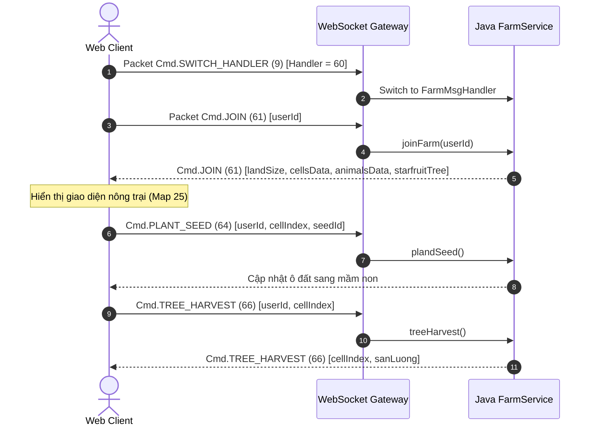

# KẾ HOẠCH TRIỂN KHAI HỆ THỐNG NÔNG TRẠI (MAP 25)
**Avatar Teamobi Farm System (Map 25) Web Implementation Specification**
*Ngày lập: 10/11/2026 | Đối chiếu trực tiếp mã nguồn Java Server `FarmService.java`, `FarmMsgHandler.java` và MariaDB `farmitems`*

---

## 1. Tổng Quan Kiến Trúc Nông Trại (Map 25)

Hệ thống Nông Trại (Farm System) là tính năng cốt lõi và biểu tượng nhất của thế giới Avatar Teamobi.
Người chơi có thể canh tác đất nông nghiệp, gieo hạt, tưới nước, bón phân, diệt sâu bọ, thu hoạch nông sản bán kiếm Xu, chăn nuôi gà, bò sữa, nuôi cá và chăm sóc cây khế thần thoại.

**Nguyên tắc bảo toàn tuyệt đối:**
- **Không tự chế gói tin (No custom packets):** Sử dụng chính xác 100% các Packet IDs và cấu trúc tuần tự byte trong `Cmd.java` và `FarmService.java`.
- **Không sửa đổi cơ sở dữ liệu:** Tương thích trực tiếp với dữ liệu lưu trữ tại bảng `farm_data` và danh mục hạt giống tại `farmitems`.
- **Giữ nguyên chu kỳ sinh trưởng gốc:** Bảo toàn thời gian sinh trưởng theo phút và sản lượng thu hoạch theo tiêu chuẩn Teamobi.

---

## 2. Danh Mục Hạt Giống & Chu Kỳ Sinh Trưởng (Dữ Liệu MariaDB `farmitems`)

Dưới đây là các loại nông sản tiêu biểu được trích xuất trực tiếp từ bảng `farmitems` của server:

| ID | Tên Nông Sản | Thời Gian Chín (`so_phut_chin`) | Sản Lượng Cơ Sở (`san_luong_khi_chin`) | Giá Bán (`gia_san_pham`) |
| :---: | :--- | :---: | :---: | :---: |
| **0** | Cà Chua | 260 phút (~4.3 giờ) | 75 | 10 Xu |
| **1** | Cà Rốt | 380 phút (~6.3 giờ) | 108 | 10 Xu |
| **2** | Khóm (Dứa) | 600 phút (~10 giờ) | 165 | 10 Xu |
| **3** | Dưa Hấu | 480 phút (~8.0 giờ) | 138 | 10 Xu |
| **4** | Nho | 960 phút (~16 giờ) | 240 | 10 Xu |
| **5** | Hoa Hồng | 120 phút (2.0 giờ) | 45 | 10 Xu |
| **6** | Lúa | 2280 phút (~38 giờ) | 720 | 10 Xu |
| **7** | Xoài | 1440 phút (24 giờ) | 360 | 10 Xu |
| **8** | Thanh Long | 720 phút (12 giờ) | 189 | 10 Xu |
| **9** | Hướng Dương | 720 phút (12 giờ) | 189 | 10 Xu |
| **10**| Hoa Tulip | 360 phút (6.0 giờ) | 108 | 10 Xu |
| **41**| Bí Ngô | 120 phút (2.0 giờ) | 80 | 10 Xu |
| **43**| Cây Ớt | 60 phút (1.0 giờ) | 45 | 10 Xu |

---

## 3. Bản Đồ Giao Thức Nhị Phân Nông Trại (Network Protocol Mapping)

### 3.1. Gói tin `Cmd.JOIN` (61) - Khởi tạo nông trại
- **Client -> Server:**
  - `writeInt(userId)`: ID người chơi sở hữu nông trại (hỗ trợ vào thăm trang trại bạn bè).
- **Server -> Client Payload:**
  - `writeInt(userId)`
  - `writeByte(landSize)`: Số lượng ô đất đã mở (mặc định từ 6 đến 30 ô).
  - Lặp `i = 0` đến `landSize - 1`:
    - `writeByte(cropType)`: ID hạt giống (`-1` nếu là ô đất trống).
    - Nếu `cropType >= 0`:
      - `writeShort(minutesSincePlanted)`: Số phút đã trôi qua kể từ khi gieo hạt.
      - `writeByte(sucKhoe)`: Điểm sức khỏe cây trồng ($0 - 100$).
      - `writeByte(trangThai)`: $1$ bình thường, $100$ là héo khô.
      - `writeBoolean(isWatered)`: Ô đất đã được tưới nước chưa.
      - `writeBoolean(isFertilized)`: Ô đất đã được bón phân chưa.
      - `writeBoolean(isHarvestable)`: Cây đã chín và có thể gặt chưa.
  - `writeByte(animalCount)`: Số lượng gia súc, gia cầm.
  - Lặp qua từng con vật:
    - `writeByte(animalId)`
    - `writeInt(health)`
    - `writeByte(level)`
    - `writeByte(resourceCount)` (sản lượng trứng/sữa tích lũy)
    - `writeByte(nextProductionTime)`
    - `writeBoolean(isAlive)`
    - `writeBoolean(isReadyForBreeding)`
    - `writeBoolean(isHarvestable)`
  - Thông số chuồng trại:
    - `writeByte(chuongBoSize)`
    - `writeByte(hoCaSize)`
    - `writeShort(cayKheLevel)`
    - `writeShort(imgCayKhe)`
    - `writeShort(imgQuaKhe)`
    - `writeShort(soKheCoTheThuHoach)`
    - `writeShort(0)`, `writeShort(0)`, `writeShort(0)`

### 3.2. Gói tin Gieo Hạt `Cmd.PLANT_SEED` (64)
- **Client -> Server:**
  - `writeInt(userId)`
  - `writeByte(indexCell)` (ô đất số mấy: $0, 1, 2, ...$)
  - `writeByte(idSeed)` (loại hạt giống trong kho)
- **Xử lý Server:** Trừ 1 hạt giống trong kho, gán `cropType = idSeed`, thiết lập `growthTime = 0`, `sucKhoe = 100`.

### 3.3. Gói tin Thu Hoạch `Cmd.TREE_HARVEST` (66)
- **Client -> Server:**
  - `writeInt(userId)`
  - `writeByte(indexCell)`
- **Server -> Client:**
  - `writeByte(indexCell)`
  - `writeShort(sanLuong)`: Số lượng nông sản thu được:
    $$\text{sản lượng} = (\text{san\_luong\_khi\_chin}) \times \frac{\text{sucKhoe}}{100}$$

---

## 4. Thiết Kế Màn Hình Nông Trại Web Client (`FarmScreen.ts`)

### 4.1. Cấu trúc lớp đối tượng
- `FarmScreen extends GameScreen`:
  - `landItems: LandItemModel[]`: Quản lý 30 ô đất canh tác sắp xếp theo lưới isometric / 2D grid chuẩn Avatar 2.5.8.
  - `animals: AnimalModel[]`: Gà di chuyển ngẫu nhiên trong sân, bò trong chuồng, cá bơi dưới ao.
  - `starfruitTree: StarfruitTreeModel`: Cây khế ở góc trên bên phải với các chùm quả chín vàng.
  - `warehouse: FarmWarehouseModel`: Quản lý hạt giống dự trữ và nông sản thu hoạch.

### 4.2. Trạng thái hiển thị từng ô đất
Tùy thuộc vào tỷ lệ tăng trưởng:
$$\text{Tỷ lệ chín} = \frac{\text{minutesSincePlanted}}{\text{time\_grow\_minute}}$$
1. **Giai đoạn 0 (0% - 30%):** Ô đất ướt/khô với mầm non mới nhú (Sprite mầm xanh).
2. **Giai đoạn 1 (30% - 80%):** Cây đang lớn (Sprite thân lá sum suê).
3. **Giai đoạn 2 (100%):** Cây ra quả chín vàng/đỏ sẵn sàng thu hoạch (Sprite nông sản rực rỡ).
4. **Biểu tượng cảnh báo:** Giọt nước (thiếu nước), con sâu (cần phun thuốc), cỏ dại (cần nhổ cỏ).

### 4.3. Thanh công cụ tương tác dưới đáy màn hình (Action Toolbar)
Hỗ trợ cả bàn phím số J2ME (1-9) lẫn thao tác chạm (Touch) và chuột:
1. `Bình tưới nước`: Bấm để tưới các ô đất bị khô.
2. `Bao phân bón`: Rút ngắn thời gian sinh trưởng.
3. `Bình thuốc sâu`: Diệt sâu bệnh tăng sức khỏe cây.
4. `Bao hạt giống`: Mở hộp chọn hạt giống để gieo.
5. `Liềm thu hoạch`: Quét qua các ô đất chín để gặt hàng loạt.
6. `Cửa hàng / Kho`: Xem nông sản và bán kiếm Xu.

---

## 5. Lộ Trình Triển Khai Từng Bước (Implementation Roadmap)

| Giai đoạn | Nội dung công việc | File đích | Tiêu chí nghiệm thu |
| :---: | :--- | :--- | :--- |
| **P1** | Xây dựng Data Models & Network Handler | `packages/game-client/src/farm/FarmModel.ts`, `FarmNetworkHandler.ts` | Parse thành công gói tin `Cmd.JOIN` (61) từ Java Server thật |
| **P2** | Xây dựng Renderer Tilemap Nông Trại (Map 25) | `packages/game-client/src/farm/FarmScreen.ts` | Hiển thị trọn vẹn sân vườn, chuồng bò, ao cá, cây khế và các ô đất trên WebGL 2 |
| **P3** | Thao tác Trồng cây & Thu hoạch nông sản | `FarmActionController.ts` | Gieo hạt `PLANT_SEED` (64) và gặt `TREE_HARVEST` (66) thành công vào kho |
| **P4** | Chăn nuôi & Cửa hàng Nông trại | `FarmShopModal.ts`, `AnimalManager.ts` | Mua hạt giống bằng Xu, nuôi gà nhặt trứng, bán nông sản |
| **P5** | Kiểm thử E2E & Tương tác Multiplayer Farm | `tools/test_farm_e2e.js` | Tự động hóa kiểm thử chu trình nông trại 100% PASS |

---

## 6. Kết Luận
Kế hoạch triển khai Hệ Thống Nông Trại Map 25 đã được thiết kế chi tiết với cơ sở kỹ thuật đối chiếu 1:1 từ mã nguồn gốc. Quá trình phát triển sẽ tiếp nối trực tiếp trên nền tảng WebGL 2 Engine đã được ổn định.
