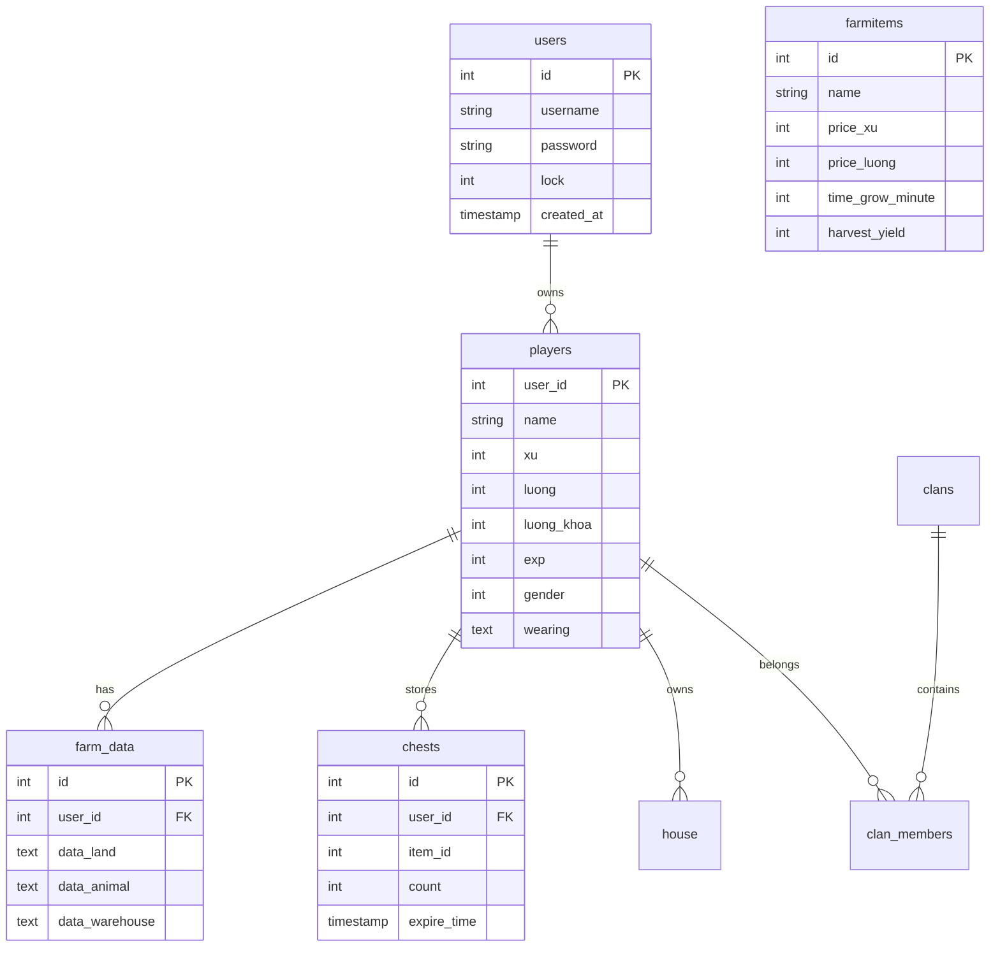

# BẢN ĐỒ GIAO THỨC VÀ KIẾN TRÚC GAMEPLAY AVATAR 2.5.8
**Avatar Teamobi Binary Protocol & Server Gameplay Reverse Engineering Document**
*Ngày thực hiện: 10/11/2026 | Đối chiếu trực tiếp từ Java Server (`Avatar-Sv-master-master`) và MariaDB (`avatar_2x`)*

---

## 1. Cấu Trúc Gói Tin Nhị Phân (Binary Packet Framing)

Giao thức Avatar Teamobi hoạt động trên kết nối TCP hướng dòng (được chuyển tiếp nguyên vẹn qua WebSocket Gateway):

```
+---------------+------------------------+------------------------------------+
|  Cmd (1 byte) |  Payload Length (2 B)  |       Payload Data (N bytes)       |
+---------------+------------------------+------------------------------------+
```
- **Cmd (`byte`):** Giá trị từ `-128` đến `127`.
- **Payload Length (`short` / 2 bytes Big-Endian):** Độ dài của phần dữ liệu theo sau.
- **Payload Data:** Đọc/ghi tuần tự bằng chuẩn `DataInputStream` / `DataOutputStream` của Java (hỗ trợ `readByte`, `readShort`, `readInt`, `readUTF`, v.v.).
- **Mã hóa:** Trước khi đăng nhập, client và server thực hiện bắt tay mã hóa `Session Handshake (-27)`. Một khóa mảng byte ngẫu nhiên (độ dài 23 bytes) được trao đổi; mọi byte từ gói tin sau đó được XOR/xoay khóa đối xứng hai chiều.

---

## 2. Bảng Đối Chiếu Packet ID & Server Handler

Dưới đây là các nhóm Packet IDs chính được trích xuất từ `avatar.constants.Cmd` và các Server Handler tương ứng:

### 2.1. Nhóm Xác Thực & Hệ Thống Core (`MessageHandler.java`)
| Packet Constant | Cmd ID | Hướng | Mô tả Payload & Logic |
| :--- | :---: | :---: | :--- |
| `HAND_SHAKE` | `-27` | 2-chiều | Client gửi chuỗi handshake, server phản hồi session key mã hóa đối xứng. |
| `LOGIN` | `0` | C -> S | `writeUTF(username)`, `writeUTF(password)`, `writeUTF(version)`. |
| `LOGIN_SUCESS` | `1` | S -> C | Trả về `userId` (`int`), `xu` (`int`), `luong` (`int`), thông tin nhân vật, set đồ mặc định. |
| `LOGIN_FAIL` | `2` | S -> C | `writeUTF(errorMessage)`. Báo sai mật khẩu, tài khoản bị khóa, v.v. |
| `SERVER_INFO` | `4` | S -> C | `writeUTF(announcement)` - Tin nhắn thông báo toàn server. |
| `DISCONNECT` | `-1` | S -> C | Ngắt kết nối và đóng socket. |

### 2.2. Nhóm Di Chuyển & Thế Giới Park (`ParkMsgHandler.java` / `ParkService.java`)
| Packet Constant | Cmd ID | Hướng | Mô tả Payload & Logic |
| :--- | :---: | :---: | :--- |
| `SWITCH_HANDLER` | `9` | C -> S | `writeByte(subHandlerId)`: Chuyển router server sang Park (9), Farm (60), Casino, v.v. |
| `JOIN_PARK` | `19` | C -> S | `writeByte(mapId)`, `writeByte(areaId)`. Vào khu vực cụ thể. |
| `JOIN_PARK_SUCESS`| `19` | S -> C | Danh sách người chơi hiện diện, tọa độ ban đầu `(x, y)`, danh sách NPC trong map. |
| `MOVE_PARK` | `20` | 2-chiều | `writeInt(userId)`, `writeShort(x)`, `writeShort(y)`. Đồng bộ di chuyển thời gian thực. |
| `CHAT_PARK` | `21` | 2-chiều | `writeInt(userId)`, `writeUTF(chatMsg)`. Hiển thị bong bóng chat trên đầu. |
| `USER_LEFT_PARK`| `22` | S -> C | `writeInt(userId)`: Người chơi rời khu vực. |
| `FEELING` | `-85`| 2-chiều | Biểu cảm cảm xúc (cười, khóc, giận dữ, tim bay...). |

### 2.3. Nhóm Nông Trại - Map 25 (`FarmMsgHandler.java` / `FarmService.java`)
| Packet Constant | Cmd ID | Hướng | Mô tả Payload & Logic |
| :--- | :---: | :---: | :--- |
| `JOIN` | `61` | C -> S | `writeInt(userId)`: Tải toàn bộ dữ liệu nông trại của người chơi (hoặc bạn bè). |
| `JOIN` | `61` | S -> C | Trả về: `landSize`, trạng thái từng ô đất (loại cây, phút đã trồng, sức khỏe, tưới nước, sâu bệnh), số vật nuôi (gà, bò, cá), kho nông sản. |
| `PLANT_SEED` | `64` | C -> S | `writeInt(userId)`, `writeByte(cellIndex)`, `writeShort(seedId)`. Gieo hạt giống. |
| `TREE_HARVEST` | `66` | C -> S | `writeInt(userId)`, `writeByte(cellIndex)`. Thu hoạch nông sản vào kho. |
| `OPEN_LAND` | `70` | C -> S | Mua thêm ô đất canh tác mới bằng Xu. |
| `BUY_ITEM` | `62` | C -> S | `writeShort(itemId)`, `writeShort(quantity)`. Mua hạt giống/phân bón từ Cửa hàng nông trại. |
| `BUY_ANIMAL` | `71` | C -> S | `writeByte(animalType)`. Mua gà con, bò con, cá giống. |
| `INVENTORY` | `60` | C -> S | Xem kho nông trại (hạt giống, nông sản, phân bón, thuốc trừ sâu). |
| `STEAL` | `65` | C -> S | Ăn trộm nông sản nhà hàng xóm (nếu đủ điều kiện chín và chó không cắn). |

### 2.4. Nhóm Khu Giải Trí & Casino (`CasinoMsgHandler.java` & Minigames)
| Packet Constant | Cmd ID | Hướng | Mô tả Payload & Logic |
| :--- | :---: | :---: | :--- |
| `JOIN_CASINO` | `30` | C -> S | Vào sòng bạc giải trí. |
| `BAU_CUA` | `50` | 2-chiều | Xử lý đặt cược Bầu Cua Tôm Cá, đếm ngược phiên, mở bát và trả thưởng. |
| `DIAMOND` | `51` | 2-chiều | Minigame xếp Kim Cương thi đấu tính điểm. |
| `TIEN_LEN` | `52` | 2-chiều | Đánh bài Tiến Lên Miền Nam đếm lá. |
| `PHOM` | `53` | 2-chiều | Đánh bài Phỏm (Tá Lả). |
| `RACE_PET` | `55` | 2-chiều | Trường đua thú: đặt cược vật nuôi chạy đua. |

---

## 3. Cấu Trúc Cơ Sở Dữ Liệu MariaDB (`avatar_2x`)

Hệ thống lưu trữ trên cơ sở dữ liệu `avatar_2x` bao gồm 34 bảng. Các bảng nòng cốt gồm:



### 3.1. Bảng `players`
- `user_id`: Khóa chính liên kết bảng `users.id`.
- `name`: Tên hiển thị của nhân vật.
- `xu`: Tiền tệ Xu (nông trại, câu cá, giao dịch dân gian).
- `luong`: Tiền tệ Lượng (nạp thẻ, đồ thời trang cao cấp, mở đất nhanh).
- `wearing`: JSON mảng các Part IDs trang bị đang mặc trên người (quy định 10 layer avatar).

### 3.2. Bảng `farm_data` & `farmitems`
- `farm_data`: Lưu trữ chuỗi JSON cấu trúc trạng thái trang trại của từng người chơi:
  - `data_land`: Mảng các ô đất, mỗi phần tử gồm: `{ "id": 0, "seed": 1, "planted_at": 1731175200, "health": 100, "water": true, "pest": false }`.
  - `data_animal`: Danh sách vật nuôi trong chuồng gà, chuồng bò, hồ cá (tuổi, thời gian cho ăn, sản lượng trứng/sữa).
  - `data_warehouse`: Số lượng nông sản dự trữ chờ bán cho lái buôn.
- `farmitems`: Danh mục 15 loại cây trồng chính thức của Teamobi (Cà chua, Cà rốt, Ngô, Lúa, Dưa hấu, Hoa hồng, v.v.) kèm thời gian chín và giá trị thu hoạch.

---

## 4. Bảng So Sánh Tính Năng (Web Client vs Java Server)

| Phân hệ Game | Trạng thái Java Server | Trạng thái Web Client | Đánh giá |
| :--- | :---: | :---: | :---: |
| **Bản đồ Thế giới (World Map 8 khu)** | Sẵn sàng (100%) | Đã hoàn thành (100%) | **VERIFIED** |
| **Đăng nhập & Xác thực Seamless** | Sẵn sàng (100%) | Đã hoàn thành (100%) | **VERIFIED** |
| **Di chuyển & Multiplayer Park** | Sẵn sàng (100%) | Đã hoàn thành (100%) | **VERIFIED** |
| **Chat 2 chiều & Tên người chơi** | Sẵn sàng (100%) | Đã hoàn thành (100%) | **VERIFIED** |
| **10 Layer Trang phục Avatar** | Sẵn sàng (100%) | Đã hoàn thành (100%) | **VERIFIED** |
| **Nông trại (Map 25) - Trồng trọt** | Sẵn sàng (100%) | Đã lên kế hoạch kiến trúc | **READY TO IMPLEMENT** |
| **Chăn nuôi (Gà, Bò, Cá)** | Sẵn sàng (100%) | Đã trích xuất cấu trúc packet | **READY TO IMPLEMENT** |
| **Khu Giải Trí & Casino (Bầu Cua)** | Sẵn sàng (100%) | Handler đã được ánh xạ | **PLANNED** |
| **Nhà ở & Nội thất (Housing)** | Sẵn sàng (100%) | Database schema đã ánh xạ | **PLANNED** |

---

## 5. Kết Luận & Hướng Tiếp Cận Kế Tiếp
Toàn bộ mã nguồn Java Server và Database đã được giải mã minh bạch. Không cần thiết kế lại giao thức hay thay đổi cấu trúc bảng cơ sở dữ liệu. Bước tiếp theo tập trung triển khai giao diện và logic tương tác Nông trại (Map 25) trên Web Client theo đúng chuẩn packet gốc.
